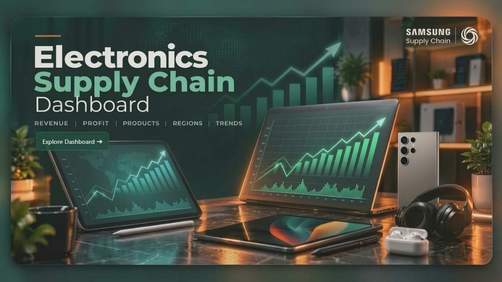
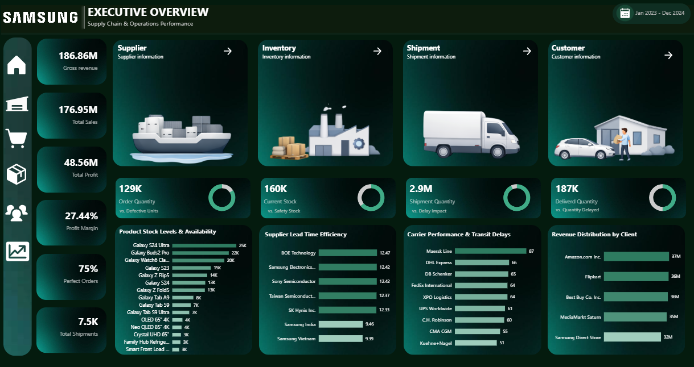
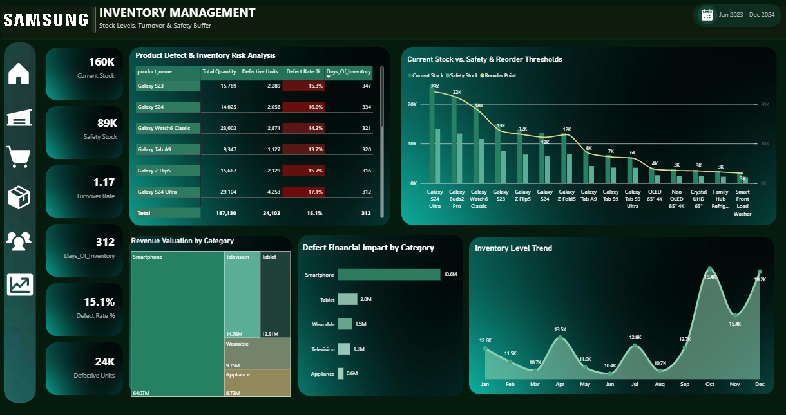
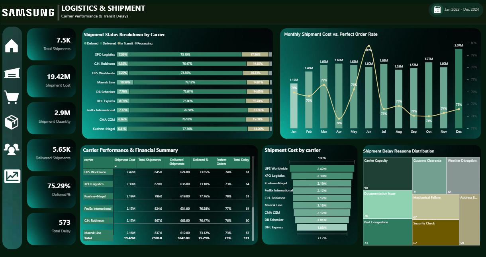
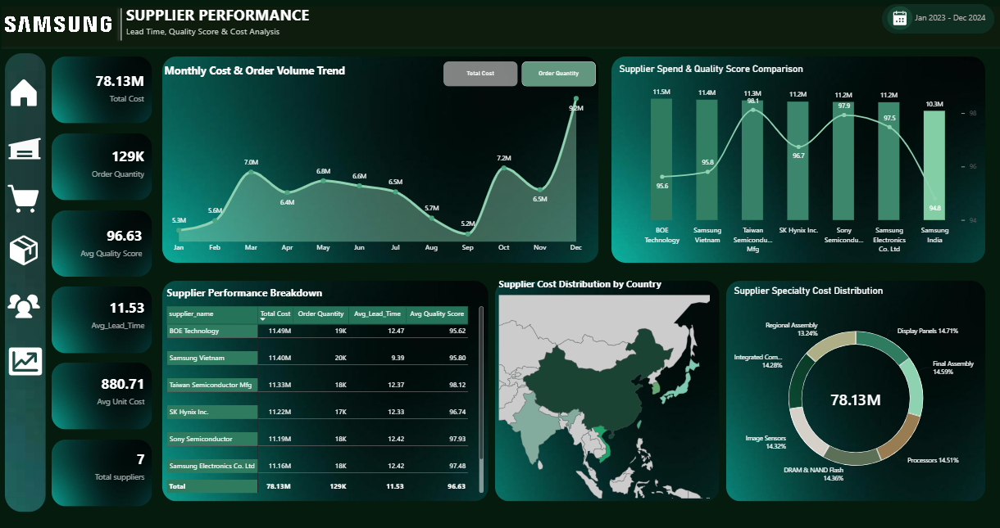
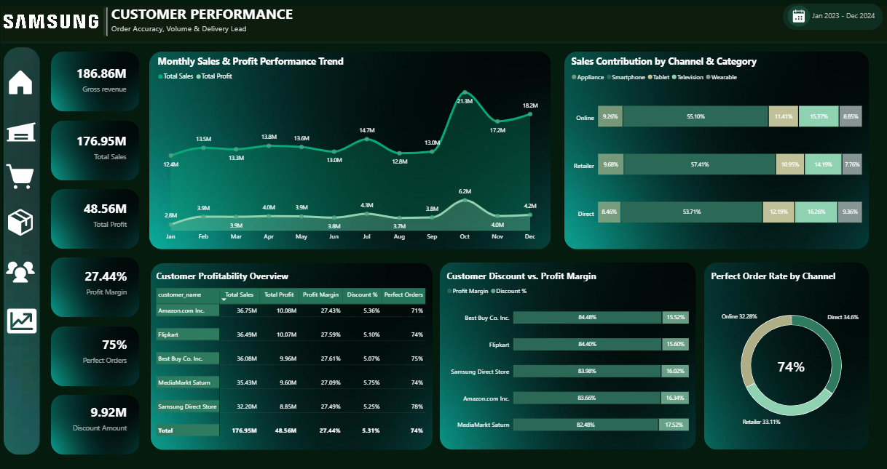
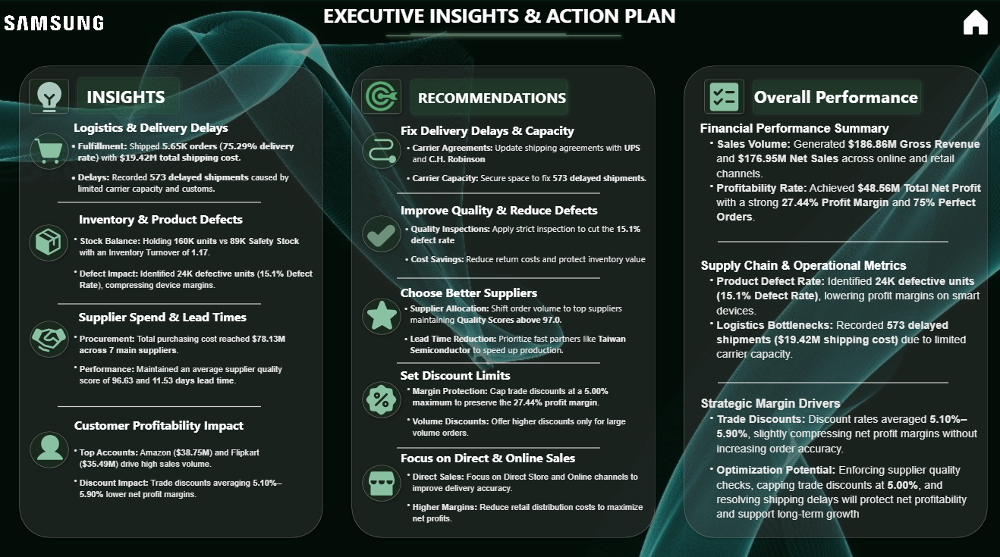

# 📊 Samsung Electronics | Supply Chain Analytics & Executive Insights

An interactive **Power BI Business Intelligence solution** designed to analyze supply chain operations, financial performance, inventory management, production quality, logistics efficiency, supplier performance, and customer profitability.

This project transforms raw operational data into actionable business insights through **data preparation, multi-fact data modeling, DAX calculations, interactive visualizations, and executive-level reporting**.

The solution consists of six analytical report pages, supported by a dedicated Home page for navigation and an Executive Insights report that summarizes key findings and strategic recommendations.

---

## 📈 Dashboard Overview

The project includes six analytical dashboards and a dedicated Home page.

### 1. Executive Overview

**Purpose:** Monitor overall business performance through financial and operational KPIs.

**Key Analysis:**
- Total Revenue and Gross Revenue.
- Profit and Profit Margin.
- Order Volume and Sales Trends.
- Product and Regional Performance.
- High-level Financial and Operational KPIs.

**Business Value:**
Provides stakeholders with a consolidated view of business performance and helps identify areas requiring further investigation.

---

### 2. Inventory & Production Dashboard

**Purpose:** Evaluate inventory efficiency, stock availability, and manufacturing quality.

**Key Analysis:**
- Current Stock Levels vs. Safety Stock.
- Reorder Points and Inventory Turnover.
- Defect Rate and Defective Units.
- Production Batch Performance.
- Facility Utilization.

**Business Value:**
Helps identify potential inventory risks, product quality issues, and opportunities to improve operational efficiency.

---

### 3. Logistics & Shipment Performance

**Purpose:** Monitor shipment performance and fix delivery delays.

**Key Analysis:**
- Delivery Rate and Shipment Delays.
- Carrier Performance.
- Delayed Shipments by Country.
- Shipment Status and Fulfillment Efficiency.
- Logistics Costs.

**Business Value:**
Supports the investigation of delivery delays, carrier performance issues, and opportunities to improve fulfillment reliability.

---

### 4. Supplier & Procurement Analytics

**Purpose:** Evaluate supplier performance and procurement efficiency.

**Key Analysis:**
- Supplier Quality Scores.
- Procurement Spending.
- Average Lead Time.
- Supplier Performance Comparisons.
- Supplier Risk and Order Allocation.

**Business Value:**
Helps stakeholders compare suppliers using relevant performance indicators and identify opportunities to improve procurement decisions.

---

### 5. Customer & Channel Profitability

**Purpose:** Understand customer contribution and evaluate profitability-related performance.

**Key Analysis:**
- Revenue Contribution by Key Customers.
- Direct vs. Indirect Sales Channels.
- Customer Order Volume.
- Profit Margin Analysis.
- High-Volume vs. High-Margin Customers.

**Business Value:**
Helps identify valuable customer accounts, investigate margin differences, and evaluate sales channel performance.

---

### 6. Executive Insights & Strategic Plan

**Purpose:** Translate analytical findings into clear business insights and actionable recommendations.

**Key Components:**

**Executive Insights**
- Logistics and Delivery Delays.
- Inventory and Product Defects.
- Supplier Spending and Lead Times.
- Customer Profitability Impact.

**Strategic Recommendations**
- Improve Delivery Performance.
- Reduce Product Defects.
- Optimize Supplier Selection.
- Improve Discount Policy.
- Evaluate Sales Channel Profitability.

**Executive Performance Summary**
Provides a consolidated view of financial performance, major operational challenges, and strategic priorities.

**Business Value:**
Connects analytical results with potential improvement opportunities, helping decision-makers prioritize operational efficiency, quality control, and margin protection.

---

## ⭐ Data Modeling & Multi-Fact Star Schema

The project uses a **multi-fact dimensional data model** to support analysis across different supply chain processes.

### 🟦 Fact Tables

| Fact Table | Analytical Purpose |
|---|---|
| `fact_sales` | Sales transactions, revenue, discounts, order numbers, and profitability metrics. |
| `fact_inventory` | Warehouse stock levels, reorder points, inventory IDs, and safety stock indicators. |
| `fact_shipment` | Shipment tracking, carriers, delivery dates, transit delays, and shipment status. |
| `fact_procurement` | Purchasing orders, unit costs, lead times, PO numbers, and quality scores. |
| `fact_production` | Batch production, defect rates, defective units, and manufacturing output. |

### 🟩 Dimension Tables

| Dimension Table | Description |
|---|---|
| `dim_product` | Product catalog, product lines, categories, specs, colors, and unit costs. |
| `dim_customer` | Customer account names, annual volume USD, channel types, and country locations. |
| `dim_supplier` | Vendor details, supplier tiers, quality scores, cities, and specialties. |
| `dim_facility` | Manufacturing facilities, facility types, annual capacity, and locations. |
| `dim_date` | Date attributes, week numbers, quarters, day names, and time intelligence logic. |

### 📐 Model Structure Diagram

```text
┌──────────────┐                                            ┌──────────────┐
│ dim_product  │                                            │ dim_customer │
└──────┬───────┘                                            └──────┬───────┘
       │                                                           │
       ├──────────────┬──────────────┬──────────────┬──────────────┤
       │              │              │              │              │
┌──────▼───────┐┌─────▼────────┐┌────▼─────────┐┌───▼──────────┐┌──▼───────────┐
│fact_inventory││  fact_sales  ││fact_produc.. ││fact_procure..││ fact_shipment│
└──────▲───────┘└─────▲────────┘└────▲─────────┘└───▲──────────┘└──▲───────────┘
       │              │              │              │              │
       │              │              │              │              │
┌──────┴───────┐      │       ┌──────┴───────┐      │       ┌──────┴───────┐
│   dim_date   ├──────┴───────┤ dim_facility ├──────┴───────┤ dim_supplier │
└──────────────┘              └──────────────┘              └──────────────┘
```

---

## 🛠️ Tools & Technologies

### Power BI & Data Analytics

- **Power BI** — Interactive dashboards and business reporting.
- **Power Query** — Data cleaning, transformation, and ETL.
- **DAX** — Business calculations and analytical measures.
- **Dimensional Data Modeling** — Multi-Fact tables, dimension tables, and relationships.
- **Data Visualization** — KPI cards, charts, and interactive report layouts.

---

## 📁 Project Structure

```text
Samsung-Electronics-Supply-Chain-Analytics/
│
├── Samsung Electronics Supply Chain.pbix
├── README.md
│
└── Images/
    ├── Home.png
    ├── Executive_Overview.png
    ├── Inventory_Management.png
    ├── Shipment_Performance.png
    ├── Supplier_Performance.png
    ├── Customer_Performance.png
    └── Executive_Insights.png
```

---

## 📸 Dashboard Preview

### 🏠 Home Page

The main navigation page provides access to the analytical dashboards and executive report.



### 📈 Executive Overview

Provides a high-level view of financial performance, sales trends, profitability, and key operational indicators.



### 📦 Inventory & Production

Analyzes inventory levels, safety stock, inventory turnover, production quality, and defective units.



### 🚚 Shipment Performance

Evaluates delivery performance, shipment delays, carrier efficiency, and logistics costs.



### 🏭 Supplier & Procurement

Examines supplier quality, procurement spending, lead times, and supplier performance.



### 👥 Customer & Channel Profitability

Analyzes customer contribution, sales channels, and profitability-related performance indicators.



### 💡 Executive Insights & Strategic Recommendations

Summarizes key analytical findings, operational challenges, and data-driven recommendations to support business decision-making.


